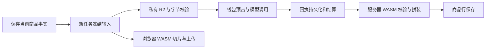

# AI识图：共享主题识别与事实拼装

2026-11-03 更新。所有商品共用画面识别提示词。模型生成短主题、画面描述与 5 个相关标签；商品类型和规格由管理员确认。保存直接覆盖当前配置，没有草稿版本、发布版本或历史选择。

## 2026-11-03：画面描述与五个标签实测

00:48–00:53（Asia/Shanghai），通过真实 React 图片测试入口、本地正常 Cookie 会话和标准 API 数据库角色，使用当前 `qwen3.7-flash` 完成三次独立调用。图片为 `SZ-9BXIE0611-0027.jpg`（人物）、`SZ-9BXIE0610-0071.jpg`（猫与杯子）、`SZ-9BXIE0610-0001.jpg`（几何人脸）。每份回包均包含完整画面描述、5 个不同的相关标签；与两个固定标签合并后均为 7 个，GET 回读与独立数据库查询一致。

三张原图均复用既有浏览器 WASM 预处理（长边最多 1024、JPEG q75），实际私有上传分别为 281703、75082、152811 字节。正式服务端完整读取校验后才购买模型调用。临时 1421 端口的 R2 跨域上传被拒绝，未调用模型、未扣费；切回已有 1420 入口验证，没有修改桶的跨域配置。

三笔实扣分别为 ¥0.00088320、¥0.00085120、¥0.00092480，合计 ¥0.00265920。每笔一条请求、一条预占、一条结算，`absorbed_microfen=0`；重复读取不新增请求或结算。描述和五个标签使用同一次调用，未增加修正调用；输出 token 比旧短主题更多，实际费用随用量变化，不能把旧预占不足形成的平台补贴当作当前单价。

脱敏原始响应、图片摘要、组合结果及账本计数见[当前真实夹具](../../rust/crates/listing-core/tests/fixtures/ocr-qwen-live-20261103.json)，Rust 与浏览器 WASM 均重放这三份回包。旧 51 份主题回包保留为拒绝用例，不伪造新描述和标签。标准数据库角色集成测试验证正式识图的描述、完整组合标签落入商品字段，刷新、GET/POST 与 settle 恢复不重新购买；未额外向真实商品行发起正式付费任务。

桌面与 390px 窄屏已查看真实结果，窄屏无横向溢出。当前证据只覆盖三张数字油画样例，不证明所有图案泛化、纯色/模糊图的模型质量、远端部署或 Ozon 审核与在售状态。

本轮检查：`make wasm` 重建全部产物与清单，Rust 测试通过；受影响 Go 测试、架构测试、隔离 PostgreSQL 正式识图集成测试与全部 Go 包编译通过；相关前端 345 项测试、TypeScript 和生产构建通过。一次全量前端运行有 3291 项通过、18 项失败，失败位于本轮未改动的钱包额度表单、导航与 AppShell SSR 测试，未将全量测试标记为通过。

## 商品配置

标题公式为 `商品类型＋确认属性＋"画面主题"`。商品配置保存规范化事实 JSON，不接受自由指令或旧六行提示词。

```json
{"product_type_ru":"Кружка","facts_ru":"керамическая 330 мл"}
```

| 字段 | 用途 | 限制 |
| --- | --- | --- |
| `product_type_ru` | 俄文商品类型，必填 | 1–80 字；俄文字母、空格、连字符 |
| `facts_ru` | 已确认的标题属性，可留空 | 最多 120 字 |

2026-11-03 移除独立固定描述。迁移 [00035](../../db/migrations/00035_remove_ocr_description.sql) 从供应商当前配置、类目事实和商品旧事实副本中删除 `description_ru`，保留类型、属性与其他配置；原始付费回执和账单不改写。事实契约升级为 `artwork-theme-v2`；旧任务须重新准备，绑定旧事实摘要的自由方案须重新绑定。旧图片测试可读取账单，但不再套用旧结构生成文案，需重新测试。已生成的商品文案不批量改写。

同日将模型输出升级为 `artwork-theme-v3`：清晰图必须一次返回画面描述和恰好 5 个标签。模型响应的 `description_ru` 只描述画面，不是恢复商品配置中的固定描述。旧主题回包不兼容，不补造标签、不改历史账单；旧任务需重新准备。

2026-11-03 再次升级为 `artwork-theme-v4`。真实图片重试显示模型会把画面里的陶罐写成「керамические горшки」，被程序按无依据材质拦截。提示词新增一条：不要根据外观猜测画中物体的材质与属性（陶瓷、棉、金属、玻璃等），只写可见的颜色、形状和位置。拦截规则不变，仍由程序拒绝含未确认地域、身份或材质修饰的文案；旧任务需重新准备。

2026-11-03 升级为 `artwork-theme-v5`。真实图片的 v4 回包仍有 610–696 字的描述和 7 词主题，被 600 字与 6 词上限误拒。提示词把描述收紧为「两个或三个短句、不超过 600 字」，主题收紧为「严格 2–4 词」，并补充不要猜「глиняный / терракотовый / каменный」材质；硬校验放宽到 800 字与 8 词，作为模型波动的安全边界。同版把长描述与标题、标签的拦截分开：标题和标签继续拒绝材质、地域、身份词；长描述只拒绝地域、身份和商品属性词，允许描述画面中可见器物的材质，避免真实画面里的陶罐、石墙被误拒。v5 下已结算的失败回执可按同一冻结输入恢复，不重新购买；v4 旧任务仍需重新准备。

事实 JSON 最多 4 KB。属性须为单行文本，不接受汉字、控制字符或占位符。标题固定部分最多 157 字，为主题和引号留出空间。图片中出现杯子、汽车或动物，不代表商品就是杯子、汽车或动物。

## 供应商商品库界面

入口：供应商商品库 → 选择库 → 商品详情 → AI识图。商品详情保留三个页签。

| 页签 | 内容与保存方式 |
| --- | --- |
| 商品信息 | 商品资料、价格、图片、PSD、视频；普通字段失焦保存 |
| 平台字段 | Ozon 类目及默认字段；自动保存，也可手动保存并校验 |
| AI识图 | 标题公式、俄文类型、确认属性、固定标签、免费公式测试与真实图片测试 |

详情顶部的规格区统一提供切换、新增、重命名和删除。新增与重命名使用有标签的名称表单，同款内不可重名；保存失败保留输入，取消或 Escape 返回规格操作。当前规格未命名时，新增操作先引导命名。新增规格继承商品名称、同款分组和类目，价格、素材及识图配置独立维护；重命名沿用已有行的保存与并发校验。多规格删除继续经过确认，单规格删除仍由商品菜单处理。

识图两项事实点击「保存配置」即替换当前值。识图固定写回标题、描述和主题标签，不提供管理员勾选；已有输出开关不再影响新任务。俄文类型和固定标签按既有约束标记「必填」；确认属性标记「建议」，不增加保存或上架门槛。描述先拼装商品类型和确认属性，再补充模型生成的画面细节。固定标签输入后回车添加，删除即保存，1–30 个。跨页签保留尚未保存的事实；关闭详情时提示丢弃。保存失败保留输入，不展示成功状态。

真实图片测试选择原图，浏览器复用正式识图预处理，经私有 R2 上传、确认、服务端完整字节校验，调用真实模型并结算工作空间钱包。展示标题、描述、标签、处理状态和实际费用；只显示最近一次结果，不写入商品文案。

标题公式、随事实更新的标题示例和免费公式测试保留。公式测试可手填俄文画面主题，留空表示无图案；先由服务端校验事实和固定标签，再由共享 WASM 预览标题与固定标签，不调用模型、不扣费，不写入商品文案。画面描述和 5 个 AI 标签只能通过真实识图生成，公式测试不模拟这些结果。

界面移除重复锁标识和测试结果中的模型名。没有测试记录时不显示无效的读取按钮；已有记录仍可独立读取，即使当前配置未就绪。只有配置改变时才显示原输入提示，避免把旧结果当作当前配置的验证。

真实测试冻结开始时的事实、标签、模型和图片摘要。连续点击、重新打开、读取结果均复用该次测试；网络结果未知时先读取原回执，不自动再买一次。只有明确启动新的测试才重新计费。配置改变后，旧结果标明对应测试时输入。

「上架当前规格」控制供应商商品可供卖家选用，仍受库公开、价格、类目和配置校验限制。识图保存后立即供新任务读取。Ozon Seller 发布须另外取得平台回读，不能由识图或媒体任务成功推断。

## 代码与持久化

| 责任 | 代码入口 |
| --- | --- |
| 三页签及状态协调 | [supplier-row-body.tsx](../../web/src/features/supplier-dbs/supplier-row-body.tsx) |
| 事实和固定标签 | [supplier-row-copy-fields.tsx](../../web/src/features/supplier-dbs/supplier-row-copy-fields.tsx)、[product-profile-fields.tsx](../../web/src/features/supplier-dbs/product-profile-fields.tsx) |
| 免费公式测试 | [supplier-ocr-preview.tsx](../../web/src/features/supplier-dbs/supplier-ocr-preview.tsx) |
| 真实图片测试与回执恢复 | [supplier-ocr-image-test.tsx](../../web/src/features/supplier-dbs/supplier-ocr-image-test.tsx) |
| 当前配置读写 | [x1_write.go](../../internal/admin/x1/repo/x1_write.go)、[x1_prompt.go](../../internal/admin/x1/repo/x1_prompt.go) |
| 事实验证 | [profile.go](../../internal/ai/contract/profile.go) |
| 测试鉴权、输入绑定、结果读取 | [ocr_tests.go](../../internal/ai/http/ocr_tests.go)、[ocr_tests_repo.go](../../internal/ai/http/ocr_tests_repo.go) |
| 正式识图与测试共用的调用和计费 | [ocr_purchase.go](../../internal/ai/http/ocr_purchase.go) |
| 正式任务读取当前事实 | [recognition_prepare.go](../../internal/listing/read/http/recognition_prepare.go) |
| 供应商默认字段及固定识图写回策略投影 | [supplier_projection.go](../../internal/listing/read/http/supplier_projection.go) |
| 供应商 PSD / 视频实物核验与授权 | [supplier_media.go](../../internal/app/api/supplier_media.go) |

`supplier_ozon_configs` 按商品保存唯一当前行，`prompt_text`、`fixed_tags` 是识图配置的事实来源。商品保存和平台字段保存共用该行。`revision` / `expected_revision` 只用于并发覆盖保护，不存配置历史，不显示版本。平台配置 API 使用 OpenAPI 规定的 snake_case；商品资料 API 的既有 camelCase 独立保留。

迁移 [00016](../../db/migrations/00016_single_product_ocr_config.sql) 将最后保存的事实写入当前配置，删除 `prompt_revisions`、发布指针及历史触发器。旧差异、发布接口已删除。迁移不能重建被删除的历史；本地迁移前备份留在仓库外。

旧构建器、全局提示词管理、批量同步、提示词文件/目录导入、AI 复核和付费修正重试均已删除。免费 `POST .../prompt/preview` 仅校验和拼装当前输入，供 AI识图公式测试使用。

真实图片测试复用 `ai_requests`，不新建测试队列或历史表：

```text
POST /api/admin/ai/ocr-tests/{id}/upload
POST /api/admin/ai/ocr-tests/{id}/confirm
POST /api/admin/ai/ocr-tests/{id}
GET  /api/admin/ai/ocr-tests/{id}
```

服务端检查登录、组织成员、商品库权限、冻结输入、模型许可和私有图片实际字节，扣费前再次检查会话。测试编号绑定唯一购买键；并发、失败或未知结果不能用同一编号重新购买。账单和原始调用回执继续保留，这是资金核对与避免重复扣费的依据。

正式识图从当前供应商配置读取事实；自由方案仍可绑定类目事实。新任务冻结读取时的事实、标签、共享提示词摘要与模型路由。配置改动后，旧任务受新鲜度检查保护，不静默换入新输入。



图片授权及回读见 [ocr_images.go](../../internal/app/ocr_images.go)，商品行写回见 [recognition_complete.go](../../internal/listing/read/http/recognition_complete.go)。模型产生有效 usage 后，即使主题被拒绝仍有原始账单；停止文案应用，不自动付费修正。

## 当前完整链路验收（2026-10-31）

新建受控测试商品「数字油画 · 全链路验收」，选用真实 Ozon 数字油画类目 `17028964 / 94897`。通过真实 React 页面配置 40×50 см、当时的固定描述（现已移除）、两个标签、平台默认字段、平台价、原图与 PSD，临时启用供卖家创建方案。包装尺寸和重量是验收条件，不作为实际商品规格。

供应商方案在读取、创建商品行及准备任务时投影唯一当前配置；卖家只保存价格、主题等允许覆盖的字段。正式任务冻结输出开关，配置改动使旧任务不能继续套用旧输入。供应商商品库不再把所有商品写死成「事实无效」。类目树通过数组父索引保留多个 `type_id=0` 的目录；平台字段接口按 OpenAPI 使用 snake_case 和 `data.config`。

同一张猫与杯子的真实原图在「AI识图」页签中完成马克杯和鼠标垫付费测试，均返回正确商品类型、描述及固定＋主题标签；两次同步点击只购买一次。三笔独立测试各扣 `15400 microfen`，共 ¥0.00046200，每笔各一条预占、一条结算。免费公式测试在桌面和 390px 窄屏通过，当前配置无历史徽标和发布按钮。

随后用新建供应商方案执行「一键准备」，不手填生成文案：

- 标题：`Картина по номерам 40×50 см "Кот с чашкой"`。
- 描述：`Картина по номерам размером 40×50 см. Сюжет: Кот с чашкой.`。
- Tags：`#картина #по_номерам #кот_с_чашкой`。
- 原图 `SZ-9BXIE0610-0071.jpg`；真实 PSD `数字油画 PSD.psd`，93,243,996 字节。浏览器 WASM 生成 9 张 JPEG；全部上传后由浏览器公开 GET 回读，长度与 SHA256 逐张一致，刷新后文案和 `content_state=ready / media_state=ready` 保持。
- 正式识图回执 `air_aa1e02559ffe4ab56402229a903c3c48`，一笔预占与一笔结算，实扣 `15480 microfen`（¥0.00015480），无冻结余额。刷新不新增购买。供应商 PSD 授权另经浏览器完整读回，错误摘要与未绑定工作空间均返回 404。

验收前一笔正常模型调用已计费，但因旧供应商输出策略为空，没有填入文案；此项按失败记录，修复默认字段和策略接线后删除该测试草稿、重新导入原图验证。旧账单及作业仍保留。两次正式链路合计 ¥0.00030960；连同三笔独立测试，本轮实扣 ¥0.00077160，与工作空间余额差完全一致。

同时补上已存在前端按钮所需的商品行删除接口；只允许删除本工作空间的非处理中草稿，保留作业及账单。真实 UI 删除、跨工作空间拒绝、处理中拒绝及取消后删除均通过。

最终供应商测试库恢复未公开，测试规格恢复未启用；原马克杯配置恢复原值。测试方案与成功文案作为验收样本保留。Seller 写入始终关闭：样本行仍缺卖家销售价及品牌字典材料，不宣称待售或已在售。当前验证证明商品配置 → 私有图片 → 模型与扣费 → 文案落库 → WASM 切片 → 公开上传回读；不证明 Ozon 发布或远端部署。

本轮脱敏凭证见 [artwork-ocr-live-20261031.json](artwork-ocr-live-20261031.json)。既有视觉 token 未计入预付估算，超出预占的费用按现有规则由平台承担，本轮未修改定价规则。JPEG 成图以真实浏览器截图及独立解码检查；验收工具的 JPEG 预览曾显示错误绿色横纹，浏览器与 Pillow 解码正常，未因此修改渲染器。

**自动检查**：前端全量 3313 项测试通过，最终接口改动后另有 65 项受影响测试通过；TypeScript、生产构建、API 类型一致性、Knip 与 lint 通过。Lint 保留 727 条既有警告，阈值仍为 818。`go test ./...`（含临时 PostgreSQL 全量集成测试）、架构检查、全部 Go 包编译及最终 OpenAPI 契约检查通过。未更改 Rust 源码或 WASM 构建输入，直接验收已提交的真实 WASM 产物。

## 唯一的模型任务

共享提示词：[visual_prompt.ru.txt](../../internal/ai/contract/visual_prompt.ru.txt)。`artwork-theme-v5` 当前验证提示词 SHA256：`06bc97668ba663f2138bb6087e490ff519e981ec5d1fd2aad7131ff16852ba4a`。`v4` 摘要 `139ff97…`、`v3` 摘要 `4b0360d…` 与旧主题模板摘要 `cb5058b…` 仅对应下文历史验收。

模型收到预处理后的图片、商品类型提示、固定标签和主题长度预算。尺寸、材质和容量不交给模型重写。所有商品使用同一份系统提示词，一次调用完成三个文案输出，保持最多 600 输出 token、关闭思考，不增加付费修正调用。

```json
{"state":"clear","theme_ru":"Кот с чашкой","description_ru":"На рисунке кот сидит рядом с чашкой на столе. На заднем плане видны листья и цветы в тёплых тонах.","tags":["#кот","#чашка","#цветы","#листья","#тёплые_тона"]}
```

只允许这四个字段。`clear` 表示主题可辨认；`plain` 表示确认没有图案，此时主题、画面描述必须为空，标签为 `[]`；`unclear` 表示无法辨认，停止自动应用，交给人工。不能把看不清的图编成“抽象图案”。

主题目标 2–4 词；最多 8 词，应用时最多 40 字。合法主题超长时按完整单词缩短，并移除末尾孤立的连接词，保留完整画面描述和 5 个标签；无法安全缩短的单词仍拒绝。只接受俄文字母、空格和连字符。额外字段、混合字母、数字、换行、引号和超过 8 词的内容均拒绝。标题和标签中的地域、身份、材质等无依据修饰由程序拦截；长描述只拦截地域、身份与商品属性词，画面中可见器物的材质形容词不再拒绝。有限词表不是完整地名或商标识别器，新增图案仍需验收。

清晰图的画面描述为 80–800 字俄文，只允许俄文字母、空格与普通标点；提示词要求补充可见对象、动作、构图、背景和颜色，不把画中物体推断为实际商品属性。5 个标签必须互不重复，使用小写俄文字母及单下划线，每个连同 `#` 最多 30 字。缺字段、标签数量错误、重复、过长或非法文本都永久拒绝，不以主题拆词冒充 AI 生成，也不自动购买第二次调用。

## 程序拼装

规则唯一实现在 [ocr_contract.rs](../../rust/crates/listing-core/src/ocr_contract.rs)，Go 通过服务器 WASM 调用。浏览器不再解析或改写模型文案，只接收服务端已经验证、结算和写回的商品行。

```text
标题 = 商品类型 + 确认属性 + "短主题"
描述 = 商品类型 + 确认属性 + . + AI 画面描述
标签 = 固定标签 + AI 生成的 5 个画面标签
```

`plain` 仅使用固定事实和固定标签。组合标签保留固定标签在前，按不区分大小写的规则去重；总数最多 30 个，固定标签已占满时不再追加 AI 标签。最终标题最多 200 字，短主题外使用 Ozon 允许的英文直引号 `"`。

全局受限标签继续由平台统一维护，适用于所有商品的标签组合。真实图片测试及正式识图均在合并固定标签和 AI 标签后，按启用规则的完整匹配或词干匹配过滤，命中的整个标签移除，不拼回未过滤的固定标签。免费公式测试与无图案结果同样过滤固定标签；全部命中可返回空标签，标题和描述保持原拼装结果。因此去重、受限标签过滤或总数上限可能使最终新增标签少于 5 个。该规则约束标签，不代表商品或图案已通过平台审核。

服务端购买校验、回执恢复和正式回写共用 `ValidateOCR`，复用已有服务器 WASM 受限词匹配器。规则读取或匹配失败时不返回未过滤结果；真实图片测试的输入校验不可用时返回 503，不发起模型购买。测试回执按读取时的全局规则重新组合过滤，不重复计费。免费公式测试每次请求全局规则，并使用既有浏览器匹配器过滤最终组合。

正式准备会优先回放同一操作者、商品行及当前冻结输入下已结算且绑定的失败回执。共享校验通过后恢复回写，不重新领取过期租约，也不新增模型请求或扣费。识图失败时优先显示识图原因；品牌、名称等发布字段问题在识图完成后独立显示。

下列同一幅猫与杯子画面的结果是旧主题模板的历史验收。表中商品规格为受控测试条件，不代表新建了这些实际商品。

| 商品条件 | 标题 |
| --- | --- |
| 数字油画 | `Картина по номерам 40×50 см на подрамнике "Кот с чашкой"` |
| 马克杯 | `Кружка керамическая 330 мл "Кот с чашкой"` |
| 鼠标垫 | `Коврик для мыши 800×300 мм "Кот с чашкой"` |
| T 恤 | `Футболка хлопковая "Кот с чашкой"` |
| 帆布袋 | `Сумка-шоппер хлопковая 35×40 см "Кот с чашкой"` |
| 靠枕套 | `Наволочка декоративная 45×45 см "Кот с чашкой"` |

视觉主题相同是正确结果；商品类型、尺寸、容量和材质由各自配置决定。

## 调用、结算与迁移

- 识图模型由平台管理员配置。用户工作台不提供模型选择，也不读取浏览器中保存的旧选择；准备接口拒绝 `model_routing`。服务端创建识图作业时固定当前系统默认模型，已有作业与命令重放保留原模型，不受之后的默认配置变化影响。
- 每个作业只有原始购买键。重复领取仍读取同一回执；不再派生付费修正键，也不自动切换备用模型。无效主题属于永久拒绝，不能购买第二次纠正结果。
- 网络结果未知时保留现有账本恢复。先回读原始购买记录；不能把超时当成未购买。已结算结果的重放与写回不重复扣费。
- 原图摘要、当前商品事实摘要、固定标签、共享提示词摘要和模型路由进入输入快照及指纹。服务端仍检查组织、操作者、租约、额度、图片字节和输入新鲜度。
- 旧六行内容必须重新确认事实后保存；不保留兼容解析。旧契约作业不兼容，历史账单不自动套入新文案。
- [00015](../../db/migrations/00015_retire_prompt_builds.sql) 删除构建运行和样本表，取消未开始的构建作业。存在正在执行的旧构建时迁移拒绝运行，须先停止旧 worker 并完成账单结算。账单表不删除。本地运行前已备份旧构建数据。
- 删除构建 API、服务、仓储、worker、MCP 工具、前端构建器与六行编辑器。只保留当前事实配置和已有的组织、账单基础设施。

## 实测与对抗审查

工作模型为用户指定端点的 `qwen3.7-flash`，温度 0.1，关闭思考，JSON 输出，最多 600 输出 token。使用用户给定目录中的真实 JPEG；等比缩至长边 1024，原文件不改。

| 验证 | 结果 |
| --- | --- |
| 6 幅原图 × 6 个商品条件，各自真实调用 | 36 次；商品固定部分均正确保留 |
| 15 个未用于这一版开发的独立图片 | 15 次；结构均合法 |
| 生产 Go 请求构造器 → 真实模型 → 服务器 WASM | 同一猫与杯子图片，6 次均通过 |
| 前轮最终模板合计 | 57 次；56 份可应用，1 份因无依据地域修饰拒绝 |
| 本轮正常 API 完整链路 | 6 个商品条件；真实私有 R2、真实模型、本地钱包与数据库商品行全部通过 |
| 2026-10-30 累计 | 63 个不同模型响应标识；62 份可应用，1 份拒绝 |
| 错误样例 | `Гора и японская деревня`；程序返回 `unsupported_theme/permanent`，不付费修正 |
| 对抗规则 | 拒绝额外标题/标签字段、汉字、混合字母、数字、换行、引号、超长主题、无效状态及伪造商品属性 |
| 当时真实 React 页面 | 事实保存和回读、非法中文类型拒写通过；当时的修订发布流程现已移除 |

前 51 份脱敏模型回包、图片摘要、请求标识及期望结果在 [固定夹具](../../rust/crates/listing-core/tests/fixtures/ocr-qwen-live-20261030.json)，Rust 与浏览器 WASM 都回放这些原始回包。额外 6 次生产代码实测由 [可选实测测试](../../internal/listing/read/http/recognition_live_test.go)执行；只在显式提供本地凭据文件、图片和输出目录时付费。

前轮额外 6 次生产代码实测直连模型，结果保存在本地证据文件，未经过本地钱包扣费。普通 API 角色集成测试另行验证实际任务、扣费、商品行持久化、回执重放、组织隔离、租约失效，以及拒绝第二购买键。测试替身不计入真实模型调用；本轮补齐的完整链路见下一节。

前轮代码验证记录：Go 全量测试、受影响集成测试、架构测试和全部 Go 包编译；Rust 原生测试 337 项；前端测试 3328 项、TypeScript、API 生成一致性与生产构建。已运行 `make wasm` 重建并校验提交产物。

本地 Docker 镜像 `podhub-go:ocr-simplified` 构建通过，并检查包含 API 和上架 worker、不包含已删除的 `worker-prompts`。没有推送镜像。

开发阶段的旧提示词失败记录保留在本地证据中，不计入最终通过率。当前没有实拍商品图、纯色图、模糊图的外部模型质量结论；这些状态仅做了程序拒绝/拼装测试。未执行 Seller 发布，未部署远端。保存识图配置不等于商品在售。

## 正常 API 完整链路实测

2026-10-30 23:25–23:27（Asia/Shanghai）。工作空间管理员通过普通 Cookie 会话调用本地运行的生产 API；API 使用标准数据库角色。使用同一原始文件 `SZ-9BXIE0610-0071.jpg`，原图摘要与上传图片摘要保存在[脱敏证据](artwork-ocr-live-20261030.json)。图片进入真实 Cloudflare R2 私有测试桶 `podhub-test-delegate`，模型为配置中的 `qwen3.7-flash`，6 次响应标识均不同。

六份独立事实配置通过管理 API 保存，分别绑定六个验收方案和商品行。为了只验收识图内容与扣费，六份配置使用本地已同步的数字油画 schema 作为字段容器；没有把马克杯等五类的 Ozon 类目映射标成通过，也没有发布供应商商品。供应商当前配置的分支另有正常角色集成测试；本轮真实整页流程另行记录。

| 商品条件 | 持久化描述 | 持久化标签 |
| --- | --- | --- |
| 马克杯 | `Керамическая кружка 330 мл. Сюжет: Кот с чашкой.` | `#кружка #керамика #330мл #кот_с_чашкой` |
| 鼠标垫 | `Коврик для мыши размером 800×300 мм. Сюжет: Кот с чашкой.` | `#коврик #для_мыши #кот_с_чашкой` |
| 数字油画 | `Картина по номерам 40×50 см на подрамнике. Сюжет: Кот с чашкой.` | `#картина #по_номерам #кот_с_чашкой` |
| T 恤 | `Хлопковая футболка. Сюжет: Кот с чашкой.` | `#футболка #хлопок #кот_с_чашкой` |
| 帆布袋 | `Хлопковая сумка-шоппер 35×40 см. Сюжет: Кот с чашкой.` | `#шоппер #сумка #кот_с_чашкой` |
| 靠枕套 | `Декоративная наволочка 45×45 см. Сюжет: Кот с чашкой.` | `#наволочка #декор #кот_с_чашкой` |

六个标题与前文同图标题表一致。每份结果都通过 GET 和独立 PostgreSQL 查询核对：标题、描述、标签、原始模型响应、配置摘要、账单和商品行对应；每个任务恰有一笔请求和一笔结算，任务 `succeeded`、内容 `ready`、执行额度已释放。缺少上架必填字段的校验阻塞仍保留。

- 上传前确认返回 404，不冻结或扣费；真实 PUT 后，服务端私有回读的字节数和 SHA256 一致。
- 去除签名的对象读取被 R2 拒绝：HTTP 400，XML 错误为 `InvalidArgument / Authorization`，没有返回图片。错误租约确认返回 409。
- 原购买键 GET、POST 重放以及显式 settle 都返回原请求，商品修订不增加、钱包不再扣费；派生 `:retry` 购买键返回 409。
- 另一工作空间读取商品行或付款回执均返回 404。

6 次钱包合计扣费 **92,440 microfen = ¥0.00092440**。余额从 `496,233,280` 变为 `496,140,840` microfen，冻结余额为 0，独立账本结算金额之和一致。当前按已发布单价和实际 usage 算出的金额为 `333,360` microfen；现有预付封顶规则把差额 `240,920` microfen 记为平台承担，未追加扣款。这是本地计价结果，不是模型供应商发票。现有预付估算只计文本，未计视觉 token，正式定价前需单独评估该差额；本轮没有改定价或结算规则。

当时供应商库受影响测试 129 项、架构测试、TypeScript 和前端生产构建通过；旧发布状态测试已随版本流程删除。共享模型提示词和 Rust/WASM 没有再次修改，无需重复付费验证或重建 WASM。
