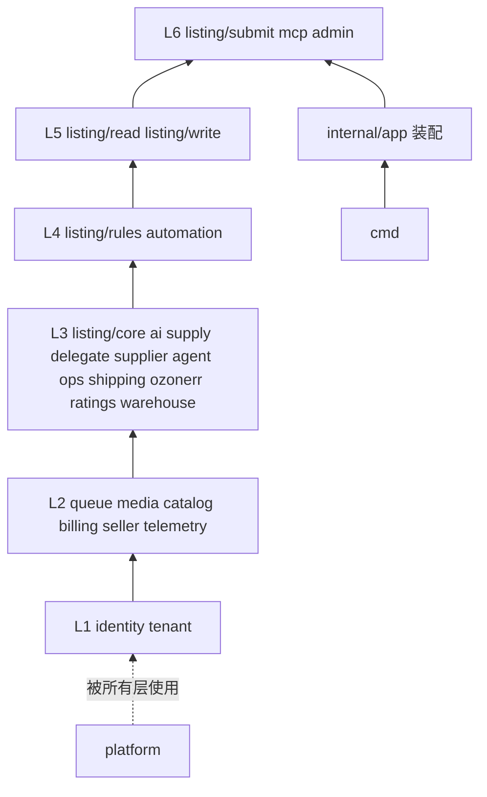
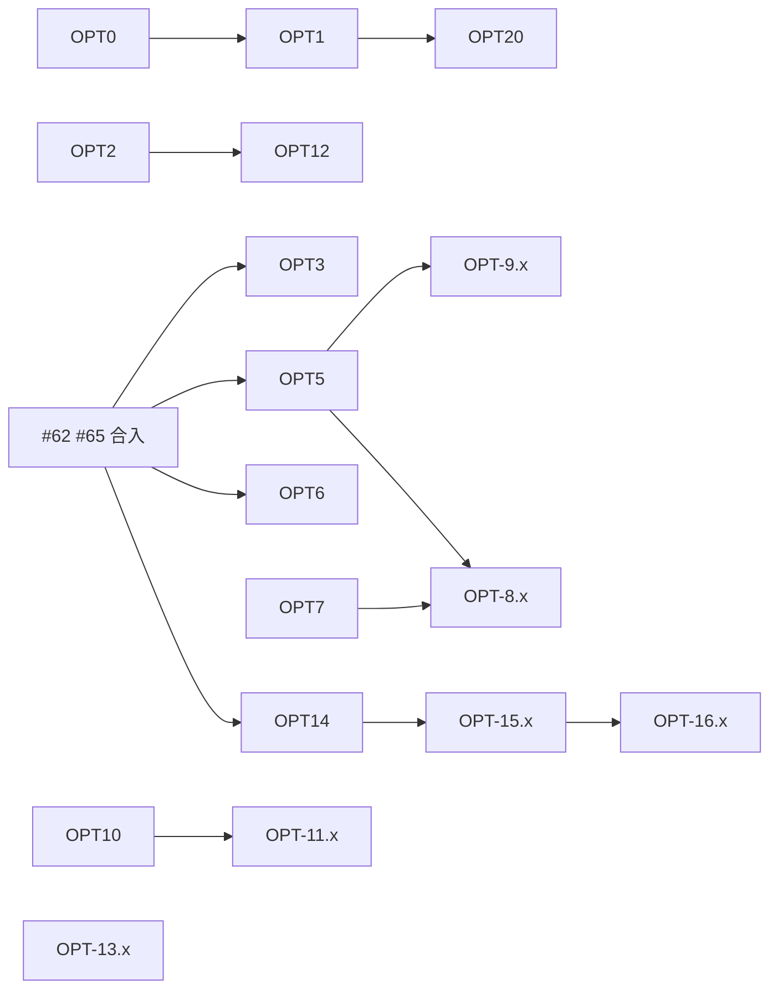

# podhub-go 优化计划（已完成，保留供追溯）

> **状态：已执行完毕。** 本文是 2026-10 基于 `main` `565e548`（PR #64 合入后）写的计划，其中的 PR 序列已基本落地。下文 §1、§2 的数字是**基线当时**的测量值，不再代表当前 `main`；§3、§4 是已执行的方案，保留用于追溯决策理由。
>
> 当前状态请看 [architecture.md](../architecture.md)（行为约束）、[architecture-tree.md](../architecture-tree.md)（目录与分层）、[decisions.md](../decisions.md)（未决事项）。新增工作不要从本文的 §4.3 续编号，按实际需求另开。

## 完成状态（核对于 `8e37ea9`，246 个提交之后）

| 项 | 状态 | 落点 / 备注 |
| --- | --- | --- |
| OPT-1 CI | 完成 | `.github/workflows/ci.yml`：push 只跑 main、`concurrency` 取消旧运行、`lint` / `web` / `test` 三个 job 并行、生成器二进制缓存。wasm 校验在 `test` job 内，没有独立的 wasm job，也没有路径过滤 |
| OPT-2 Makefile/README | 完成 | `Makefile` 的 `generate`/`ci`/`codegen-versions`；`build` 含 writer-lease |
| OPT-3 迁移守卫 | 完成 | `internal/platform/db/migrate_guard_test.go` + `db/migrations.sha256`（baselineMax 341 / 313 个文件） |
| OPT-4 许可证 | 部分 | 根 `LICENSE`、`NOTICE`、`THIRD-PARTY-LICENSES.md` 已在；**CI 尚未校验清单是否最新** |
| OPT-5 archtest 加强 | 完成 | `tests/archtest/parsepoint_test.go`；`baseline.txt` 只剩 2 行（`admin/repo/dissolve.go`、`agent/repo/wallet.go`） |
| OPT-6 集成测试共享容器 | 完成 | `tests/integration/main_test.go` 共享容器 + 模板库；62 个 Test 仍串行 |
| OPT-7 事务封装 | 完成 | `internal/platform/db/tx.go`（`InTx` + `App`/`Worker`/`Staff`/… 会话） |
| OPT-8 按域迁移到 InTx | 进行中 | 10 个域已用 `InTx`；仍有 48 个文件直接 `Begin`/`BeginTx`，集中在 admin 14、listing 8、billing 5 |
| OPT-9 `os.Getenv` 收口 | 完成 | 非测试代码里 `platform/config` 之外已为 0 |
| OPT-10 routes ⊆ spec 棘轮 | 完成 | `internal/app/routes_openapi_test.go`，白名单 `routes_openapi_allowlist.txt` |
| OPT-11 补 spec | 完成 | spec 343 个 operation / 294 path；白名单从 36 条降到 **0**。方向改为以 Go 代码为准（decisions.md D14），不再以 Rust spec 为目标 |
| OPT-12 codegen 统一 | 进行中 | 23 份配置；18 份 `chi-server`、5 份只生成 models（ai、billing、catalog-reads、ratings、stores） |
| OPT-13 响应写出收口 | 进行中 | 仍有 18 处本地 `writeJSON`/`writeErr`；`jsonwire` 只被 25 个包使用 |
| OPT-14 装配层改名 | 完成 | `wire_pr8a`/`wire_pr8b`/`wire_x2`/`adminb_*` 已全部消失 |
| OPT-15 admin 拆子单元 | 完成 | 8 个主题子单元 + `admin/core`，已登记进 `level` 表 |
| OPT-16 admin 去重 | 部分 | `PickMethod` 已收口到 `admin/shipping/contract`；其余重复规则未见后续 PR |
| OPT-17 收根包门面 | **未做** | `internal/queue/wire.go`、`internal/billing/wire.go` 的 `init` 仍未拆 |
| OPT-18 可观测性 | 完成 | slog 带 trace_id/span_id、OTLP 默认关、pgx QueryTracer、出站 `traced`、River span |
| OPT-19 River 周期任务登记表 | 完成 | `internal/app/worker/periodic.go` |
| OPT-20 wasm 统一 | 完成 | 产物都在 `wasm/dist/{server,browser,test}`，一份 `SOURCES.sha256`，`scripts/build-wasm.sh`，单一 workspace 工具链（`rust/`） |
| OPT-21 切断 gin | 完成 | `go list -deps ./cmd/api` 已不含 `gin-gonic` |
| OPT-22 切换方案 | 完成 | [cutover-plan.md](cutover-plan.md)，并已修正本文 Q1 的结论 |

### 决策项（§5.2）的实际结果

| # | 结果 |
| --- | --- |
| D1 迁移乱序 | **与推荐不同**：代码采用 `goose.WithAllowMissing()`（选项 b），并叠加 OPT-3 的迁移守卫；计划当时推荐的是 a（改迁移号）。见 [cutover-plan.md](cutover-plan.md) §4.1 |
| D2 codegen 形态 | 方向取 a（`models + chi-server`），但尚未统一：23 份里 18 份带 `chi-server` |
| D3 共享容器 | 取 a，已落地 |
| D4 Dockerfile 加 writer-lease | 加了 |
| D5 schema_revision 排序进 wasm | **未做**，`LegacyRevision` 仍在（`internal/listing/submit/draft.go`） |
| D6 OTLP 默认 | 默认关，由 `OTEL_EXPORTER_OTLP_TRACES_ENDPOINT` 开启 |
| D7 PSD 渲染 wasm | **部分**：源码已并入 `rust/crates/{render,render-wasm,psd-x}`，浏览器产物在 `wasm/dist/browser/render/`（`web_source_sha256` 与 `web_glue_sha256` 记录源码与 threaded glue）。没有 `psd-render.wasm` 服务端条目：PSD 渲染只有浏览器构建，没有服务端 ABI 组 |
| D8 前端从 spec 生成 | 方向已定，前置的 spec 补齐仍在进行（OPT-11） |
| D9 NOTICE 界面署名 | 未到：还没有日志 UI |
| D10 admin 切分粒度 | 按主题，已落地 |

---

约定（执行时遵守的）：

- Go 版是唯一版本。验收基线是 **Go 当前的输出、状态和数据**：现有测试、`internal/app/testdata/routes.txt`、`tests/integration/testdata/expected-head-fingerprint.json`、各 `testdata/` golden、wasm sha256。
- 对外继续用 `listing` 命名。路由、JSON 字段、错误码、队列 kind 都不改名。
- 不碰生产和 Ozon 真实接口。`OZON_WRITE_KILL_SWITCH`、`CLOUD_MEDIA_GC_DELETE` 的解析和语义不动。
- 分步迁移，不做一次性大搬家。每个 PR 都能单独回滚。
- 新迁移从 `00345` 起，只追加。

---

## 1. 现状盘点

### 1.1 目录树与职责

```
cmd/                 6 个进程入口：api、worker-{listing,sync,reconcile,media-gc}、writer-lease。只调 internal/app
api/                 openapi.yaml（基线 4962 行，242 path / 277 operation；现 6232 行 / 263 path / 300 operation）+ codegen/*.yaml（基线 18 份，现 23 份）
db/                  migrations（goose，基线 308 个文件、最大 00337；现 313 个、最大 00341）、queries（sqlc，10 个文件 / 73 条）、schema
internal/
  app/               唯一装配层：app.go、wire_*.go、api/（27 个文件，处理函数）、worker/、scans/
  platform/          基础设施：config、db{,/sqlc,/tenantx}、httpx、jobsched、llm、r2、seal、wasm、writer…
  <域>/              业务单元，层目录 contract/domain/service/repo/http/jobs/gen
  listing/{core,rules,read,write,submit}
tests/               archtest（分层棘轮）、integration（48 个 Test）、parity（字节比较）、testkit
wasm/                产物与 Go 嵌入（dist/server、dist/browser、dist/test）
rust/               全部 Rust 源码，单一 workspace（crates/*，Rust 1.99.0 构建）
third_party/new-api  计费公式副本（AGPL-3.0，经 go.mod replace 引入）
```

`internal` 下当时有 160 个 Go 包（现 192 个）。生产代码约 11.6 万行（现同量级），测试约 4.4 万行（现 5.8 万行）。

### 1.2 依赖方向（`tests/archtest` 现有规则）

- 三类根：`platform` 不得 import 业务和 `app`；单元不得 import `app`；`cmd` 只 import `internal/app`（R9）。
- 跨单元只能 import 层级严格更低的单元的 `contract/`。层级表在 `arch_test.go` 的 `level`。
- 层内矩阵：`domain→{domain,contract}`、`service→{domain,contract}`、`repo→{domain,contract,gen}`、`http→{service,domain,contract,gen}`、`jobs→{service,domain,contract}`。
- 第三方模块唯一位置（`onlyIn`）：relaykit→`platform/llm`，aws→`platform/r2`，wazero→`platform/wasm`，goose→`platform/db`。
- 单点解析：两个开关、`CLOUD_SELLER_BASE_URL` 等只在 `platform/config`；`app.current_org_id` 只在 `platform/db/tenantx`；`pgxpool.New*` 只在 `platform/db`。
- `baseline.txt` 当前**为空**（两段都没有行），所有规则都已满足。



### 1.3 体量与耦合

不含测试与生成物的行数（`find internal/<u> -name '*.go' ! -name '*_test.go' ! -path '*/gen/*' …| wc -l`）：

| 单元 | 行数 | 说明 |
| --- | --- | --- |
| `admin` | 33,823 | 约占生产代码 29%。`domain/` 87 个文件 1.03 万行，`repo/` 44 个文件 1.24 万行 |
| `listing/*` | 15,290 | 其中 `read` 8,259（读写 HTTP 同包） |
| `ops` | 6,254 | |
| `app` | 6,249 | `app/api` 承担大量处理函数 |
| `delegate` | 6,187 | 最大文件 `repo/seller_order.go` 1,157 行 |
| `listing/submit` | 4,252 | 根包 14 个文件仍平铺 |
| `identity` | 3,446 | 根包 22 个文件仍平铺 |

入度最高的内部包（`rg -o 'internal/[^"]+"' | sort | uniq -c`）：`admin/domain` 80、`admin/contract` 44、`identity/contract` 42、`platform/db/tenantx` 40。`admin/domain` 的入度高于任何 platform 包，说明 admin 内部是一个大池子。

### 1.4 重复代码

| 重复 | 证据 |
| --- | --- |
| `writeJSON` / `writeErr` | 约 20 处各自实现，签名不同（`retry int`、`retryAfter string`、`nosniff bool`）：`supplier/http/handler.go:536`、`automation/http/mount.go:73`、`telemetry/http/mount.go:101`、`delegate/http/handler.go:684`、`app/api/codec.go:45` 等 |
| 租户会话 SQL | `set_config('role','podhub_app',true)` 与各类 GUC 在 tenantx 之外手写约 30 处：`admin/repo/{repo,users,dissolve,wallet,shipping,digest,observe,grants}.go`、`delegate/repo/*.go`、`supplier/repo/*.go`、`billing/repo/operations.go`、`ozonerr/repo/repo.go`、`platform/writer/bootstrap.go` |
| `PickMethod` | `admin/domain/shipping.go:718` 与 `shipping/domain/classify.go:118` 函数体几乎相同，只是类型名不同 |
| `itoa` | 20 个包各定义一份 |
| 根包转发门面 | `seller/{domain,ledger,repo}_alias.go`、`queue/wire.go`、`billing/wire.go` 用再导出和 `init` 赋函数变量来维持旧限定名（共 9 个 `init`） |

### 1.5 测试与 CI 耗时

`main` 最近一次 CI（run 39042684219），总计约 5 分 40 秒：

| 步骤 | 耗时 |
| --- | --- |
| setup-go（含缓存恢复） | 29s |
| vet | 8s |
| archtest | <1s |
| **go test ./...** | **278s** |
| 生成物比对（安装 sqlc + oapi-codegen + 18 次生成） | 6s |
| post setup-go（写缓存） | 11s |

- 集成测试有 62 处调用 `migratedPool` / `postgres.Run` / `StartPostgres`，每处起一个新容器并跑完 308 个迁移。`tests/integration` 里没有 `TestMain`，也没有 `t.Parallel()`。
- `ci.yml` 同时监听 `push` 和 `pull_request`，同一个 PR 提交跑两遍（见 run 列表里成对出现的 push/pull_request）。没有 `concurrency` 取消旧运行。

---

## 2. 问题清单（按严重度）

| # | 级别 | 问题 | 证据 |
| --- | --- | --- | --- |
| Q1 | P0 | **迁移号乱序会让已迁移的库启动失败**。goose v3 默认拒绝「低于当前版本的未执行迁移」。`main` 已有 `00335–00337`，PR #62 带 `00330–00332`，PR #65 带 `00340–00341`。一个已到 `00337` 的库在 #62 合入后执行 `goose.Up` 会报 missing migrations。CI 每次都是新库，测不到。**已解决**：`gooseUp` 现在用 `goose.WithAllowMissing()`，并由 `migrate_guard_test.go` 冻结已合入文件 | `internal/platform/db/migrate.go` 的 `gooseUp`；当时探针是 `internal/platform/db/migrate.go:60` |
| Q2 | P0 | **租户 GUC 的单点解析有漏洞**。archtest 只匹配双引号字面量 `"app.current_org_id"`，反引号 SQL 里的同一文本不被发现 | `admin/repo/dissolve.go:32,60`、`billing/repo/operations.go:44` 直接 `set_config('app.current_org_id', …)` |
| Q3 | P1 | **租户事务不统一**。`tenantx.BeginApp/BeginWorker` 约 48 处调用，直接 `Begin` / `BeginTx` 82 处。其中 20 个文件完全不引用 tenantx，靠手写 `set_config` 进入角色。缺 `org_id` 时没有统一报错 | §1.4 第二行；`rg '\.Begin\(ctx\)\|BeginTx\('` |
| Q4 | P1 | **环境变量不止一个解析点**。文档要求只在 `platform/config` 读，archtest 只管 6 个名字 | `ai/service/pace.go:42`、`billing/repo/operations.go:16`、`identity/crypto.go:50`、`identity/session.go:186`、`listing/core/service/engine/engine.go:219`、`platform/db/login_role.go:16`、`seller/domain/origin.go:107` |
| Q5 | P1 | **OpenAPI 与真实路由不一致**。手写 chi 路由涉及 67 个路径（86 处注册），其中 36 个路径不在 `openapi.yaml`（`/api/listing/cards*`、`/rows*`、`/intents*`、`/jobs/*`、`/browser/*`、`/field-packs*`、`/catalog/tree` 等）。前端仓库无法只靠 spec 生成客户端 | 本文 §1.2 命令；`internal/app/testdata/routes.txt` 共 340 条 |
| Q6 | P1 | **`admin` 是上帝单元**。L6 的 admin 内部重做 shipping、supplier、billing、delegate 的规则，与低层单元重复 | §1.3；`admin/domain` 文件名含 `shipping`、`supplier_*`、`delegateadmin`、`seats`、`redeem_rules`、`pricing`；`PickMethod` 重复 |
| Q7 | P1 | **sqlc 覆盖率低**。73 条 sqlc 查询，对比约 1,091 处手写 `Exec/Query/QueryRow`；admin 一个单元手写 SQL 字面量 229 处 | `rg -c '^-- name:' db/queries`；`rg -o '\b(tx\|pool\|db\|conn\|q)\.(Exec\|QueryRow\|Query)\('` |
| Q8 | P2 | **CI 慢且重复**。`go test` 占 278s，主要是 62 次起容器加全量迁移；push 与 pull_request 双跑 | §1.5 |
| Q9 | P2 | **装配层按 PR 号命名**。`app/wire_pr8a.go`、`wire_pr8b.go`、`wire_x2.go`、`app/api/adminb_*.go`、`admin/repo/x1*.go`，读者无法从文件名找到域 | `ls internal/app internal/app/api internal/admin/repo` |
| Q10 | P2 | **oapi-codegen 用法不统一**。18 份配置，13 份带 `chi-server`，5 份（admin、automation、mcp、ops、telemetry）只生成 models。CI 把 18 条命令逐条写在 yaml 里。**部分解决**：CI 已改为 `make generate` 遍历配置，但仍 18/23 份带 `chi-server` | `grep -L chi-server api/codegen/*.yaml` |
| Q11 | P2 | **gin 被链进 API 进程**。`platform/newapibilling → third_party/new-api → gin`、`expr-lang`。HTTP 栈是 chi，gin 只是副本的传递依赖 | `go list -deps ./cmd/api \| grep gin-gonic` |
| Q12 | P2 | **许可证缺根文件**。仓库根没有 `LICENSE` / `NOTICE`；AGPL 只在 `third_party/new-api/` 里有。relaykit 也是 AGPL | `ls LICENSE* NOTICE*` |
| Q13 | P2 | **wasm 产物与校验文件分散在三处，当时两套工具链挤在同一 job**（已解决：产物与清单统一到 `wasm/dist/`，工具链统一为 `rust/rust-toolchain.toml` 的一个稳定版本） | `wasm/dist/SOURCES.sha256`、`rust/rust-toolchain.toml`、`scripts/build-wasm.sh` |
| Q14 | P3 | **构建入口不全、文档过期**。`make build` 和 `Dockerfile` 都不构建 `cmd/writer-lease`。README 的目录表仍写 `internal/config`、`internal/tenant`、`internal/ozon`、`internal/listing`（迁移前的路径）。**已解决**：`make build` 与 `Dockerfile` 都构建 `cmd/writer-lease`，README 目录表已换成当前路径 | `Makefile`、`Dockerfile`、`README.md` |
| Q15 | P3 | **可观测性只有骨架**。tracer 丢弃所有 span，没有 exporter；只有 HTTP 入口有 otelhttp；pgx、River、出站 HTTP 没有 span；slog 里没有 trace_id | `platform/observability/observability.go`；`app/app.go:47` |

`schema_revision`：服务端「按 attribute id 排序再哈希」已在 `e35148a` 落地（`internal/listing/core/revision.go`）。`draft.go:388` 仍用 `LegacyRevision` 兼容旧版本号。剩下的是把排序放进 wasm 本身，再择期退役双版本接受，见 §3.9 与 §5。

---

## 3. 优化方案

每项格式：收益 / 风险 / 工作量 / 是否破坏现有行为 / 验收。工作量用「改动面」描述。

### 3.1 项目树分层

目标树不变（三类根 + 域内固定层目录），只补齐和收口：

1. **admin 拆子单元**。仿照 `listing/*`，按主题建 `admin/{shipping,supplier,billing,delegate,catalog,users,observe,x1}`，每个子单元有自己的 `domain/repo/service/http`，登记在 `level` 表（L6）。先纯搬家，再在单独的 PR 里把与低层单元重复的规则改成调用对方 `contract`。
   - 收益：最大单元从 3.4 万行拆成每块 2–6 千行；`admin/domain` 入度 80 分散；重复规则可见。
   - 风险：未导出名字跨文件，搬家可能被迫改函数体。
   - 工作量：每个主题一个 PR，只动 `internal/admin/**`、`internal/app` 的 import 与 `level` 表。
   - 破坏行为：否（纯搬家）。去重 PR 会改函数体，用表驱动对比旧函数输出。
   - 验收：`scripts/check-pure-move.sh`、`scripts/funcbodyhash.go` 输出全 `SAME`；`routes.txt` 不变；archtest 基线仍为空。
2. **装配层按域命名**。`wire_pr8a.go → wire_supply.go / wire_delegate.go / wire_supplier.go`，`wire_pr8b.go`、`wire_x2.go` 同理，`app/api/adminb_* → admin_*`，`admin/repo/x1* → admin/x1/repo`。
   - 收益：文件名可定位；冲突面变小。风险：与进行中 PR 冲突。工作量：仅重命名。破坏行为：否。验收：同上。
3. **收掉根包门面**（`seller/*_alias.go`、`queue/wire.go`、`billing/wire.go` 的再导出）。调用方改 import 新路径，限定名用别名保持，函数体不动。
   - 收益：少 `init` 隐式接线，可读性提高。风险：可能触发「跨单元只能 import contract」，需逐个评估。工作量：每单元一个 PR。破坏行为：否。验收：archtest 基线不增；`go test ./...` 全过。
4. **identity 平铺文件**：保留现状。原因记在 [architecture-tree.md](../architecture-tree.md) §仓库边界（`net/http` 与同包未导出调用），收益低，排在最后，或者不做。

### 3.2 oapi-codegen 用法

原则不变：只生成路由和类型，响应字节手写。

1. **补齐 spec**：把 36 条手写路由补进 `openapi.yaml`，打 tag，`api/codegen/<域>.yaml` 只生成 models，不接管路由。
   - 收益：前端仓库可以从 spec 生成客户端；spec 与路由可校验。风险：schema 写得与真实字节不一致。工作量：只改 yaml 和生成物。破坏行为：否（不挂新路由）。验收：新增测试「`routes.txt` 每一条都在 spec 中」，先以白名单棘轮，逐 PR 删白名单；golden 响应用 spec 的 JSON Schema 校验通过。
2. **统一配置**：每个域一份 `api/codegen/<域>.yaml`，选项统一为 `models + chi-server`（或统一只要 models，二选一，见 §5）。CI 改成 `make generate`，脚本遍历 `api/codegen/*.yaml`。
   - 收益：新增域不用改 CI。风险：生成物字节变化。工作量：配置与 Makefile。破坏行为：否。验收：`git diff --exit-code` 通过，`routes.txt` 不变。
3. **响应写出收口到 `platform/httpx`**：提供与现有各变体**字节相同**的 `WriteJSON` / `WriteErr`（含 nosniff、Retry-After 变体），逐域替换本地实现。
   - 收益：删掉约 20 份重复。风险：换行、转义、头部顺序细节不同。工作量：每域一个小 PR。破坏行为：否。验收：替换前先给每个处理函数录响应 golden（状态码、头、正文字节），替换后逐字节相同。

### 3.3 sqlc 与 `platform/db` 薄封装

1. **薄封装（已决定）**：在 `platform/db` 新增事务入口，默认进入 `podhub_app` 并设置 `app.current_org_id`，`org_id <= 0` 直接返回 `tenantx.ErrOrgUnset`，不开事务。其他会话显式声明：Worker、Staff（`app.staff_access`）、Observer（`app.platform_observer_id`）、WalletUser、SupplierUser、AutomationGrant、Catalog 角色。实现内部仍调用 tenantx 的 SQL，GUC 名只在 tenantx 出现。

   ```go
   // 示意，不是最终签名
   err := db.InTx(ctx, pool, db.App(orgID), func(tx pgx.Tx) error { ... })
   err := db.InTx(ctx, pool, db.Staff(), fn)
   ```

   - 收益：消除 Q2/Q3；新代码默认安全。风险：老调用点设置 GUC 的顺序和条数与封装不同。工作量：先只加封装和测试（不改调用方），再按域迁移。破坏行为：否。事务内可见的 `current_setting` 与 `current_user` 必须和旧代码一致。
   - 验收：新增测试在事务里读 `current_user`、`current_setting('app.current_org_id', true)` 等全部 GUC，旧路径和新路径结果逐项相同；每个域迁移 PR 跑该域的 RLS 越权用例（两个 org，越权读写必败，GUC 缺失必败）。
2. **sqlc 只给新查询和被迁移的查询用**，不批量把 1,091 处手写 SQL 改写成 sqlc。迁移时一条 SQL 一次，SQL 文本逐字搬进 `db/queries/<域>/*.sql`。
   - 收益：类型安全，生成物可比对。风险：sqlc 推断出的类型（如 `pgtype.Numeric`）与手写 `Scan` 目标不同，导致 JSON 输出变化。工作量：按需。破坏行为：否。验收：SQL 文本 diff 为零；该查询的 golden 输出不变。
3. **sqlc 配置收口**：`sqlc.yaml` 现在 6 个块，schema 来源不一（`db/schema`、`db/schema/pr8a`、`db/agent-schema`）。统一为 `db/queries/<域>` + 共享 schema 快照（由 goose 迁移导出），去掉 `pr8a` 命名。验收：`sqlc generate` 后生成物无 diff。

### 3.4 River

现状：River 只跑 `podhub.noop` 和 3 个周期任务（error_digest、store_rating_sync、store_rating_prune）。业务状态在 `jobs` 表，由 `internal/queue` 决定。River 表由 `rivermigrate` 在 `platform/db/migrate.go` 里迁移。

- 保持「River 只当执行器」，不把业务队列迁到 River（见 §5 不做）。
- 周期任务改为在 `app/worker` 一张表里登记（kind、间隔、是否唯一），加测试：kind 不重复、都以 `podhub.` 开头。
- 收益：新增周期任务不用改多处。风险：注册顺序变化影响启动日志。工作量：小。破坏行为：否。验收：River 中注册的 kind 集合与周期与改动前一致（测试断言）。

### 3.5 配置与开关解析

1. 把 Q4 的 7 处 `os.Getenv` 收进 `platform/config`。有几处是**调用时读**（如 `login_role.go` 在 `Connect` 时读，集成测试在之前 `os.Setenv`）。收进 config 后保持同样的读取时机：config 导出按需求值的函数，不改成启动时一次读。
2. archtest 加规则：`internal/**` 非测试代码里出现 `os.Getenv` / `os.LookupEnv`，只允许在 `platform/config`。现有 7 处进基线，逐个 PR 删。
3. 不改 `OZON_WRITE_KILL_SWITCH`、`CLOUD_MEDIA_GC_DELETE` 的解析函数（`isTruthy`、`mediaDeleteEnabled`）和取值语义。

- 收益：开关全集可审计。风险：读取时机变化。工作量：每变量一个小 PR。破坏行为：否。验收：`platform/config` 的表驱动测试覆盖每个变量的空串、未设置、非法值；原调用点的测试不改断言。

### 3.6 可观测性

1. slog handler 注入 `trace_id` / `span_id`（来自 context），字段名固定。
2. OTLP exporter 由配置开启，默认关闭，默认不拨号。
3. 增加 span：pgx（`pgx.QueryTracer`，自己实现，不新增依赖）、出站 HTTP（`platform/httpx/transport.go` 包一层 otelhttp transport）、River worker。
4. 日志 UI（已决定）依赖前端仓库。服务端先固定日志字段与错误码字段，由 `ozonerr` 合入后再对齐。

- 收益：线上排障。风险：日志多出字段，属于输出变化。工作量：中，集中在 `platform/observability` 与 `app`。破坏行为：日志行多出字段；HTTP 响应与数据不变。验收：exporter 关闭时进程不打开任何新套接字（测试断言）；响应 golden 不变。

### 3.7 测试策略

1. **集成测试共享 Postgres**：`tests/integration` 加 `TestMain`，启动一个容器并迁移一次到模板库 `podhub_tpl`，`migratedPool` 改为 `CREATE DATABASE t_<n> TEMPLATE podhub_tpl`。第一步仍串行，不加 `t.Parallel()`。
   - 收益：预计省掉大部分容器启动和 61 次全量迁移，`go test` 从 278s 明显下降（以 CI 实测为准）。风险：角色是集群级对象，测试里 `ALTER ROLE` / `CREATE ROLE` 会在测试之间泄漏。工作量：`tests/testkit` 与 `migratedPool`。破坏行为：否（只动测试）。验收：`go test -json ./tests/integration` 的 Test 名单与 PASS 数和改动前相同；`expected-head-fingerprint.json` 测试通过；找出改角色的测试，单独给它们起容器。
2. **golden 先行**：所有「收口 / 去重 / 换实现」类 PR，先单独一个 PR 录 golden（响应字节、DB 行快照），再做改动 PR。
3. **迁移守卫**：新测试校验 `db/migrations` 已有文件的 sha256 不变（清单文件），新文件号大于基线最大号。这一条直接防 Q1。

### 3.8 构建与 CI 缓存

1. `on.push` 只保留 `main`，分支走 `pull_request`；加 `concurrency: ci-${{ github.ref }}`，`cancel-in-progress: true`。
2. 拆 job：`lint`（gofmt、vet、archtest、生成物比对）与 `test` 并行。（当时还打算把 wasm 单独拆一个只在路径过滤命中时运行的 job，最终没有采用：产物已入库，`test` job 开头跑一次 `scripts/check-wasm-dist.sh` 就够。）
3. 缓存 `sqlc`、`oapi-codegen` 二进制（按版本做 key）；setup-go 的模块与构建缓存保持默认。
4. `Makefile` 加 `generate`、`ci`，与 CI 跑同一套命令；`build` 加 `cmd/writer-lease`。
5. `Dockerfile` 是否加 `writer-lease` 见 §5。

- 收益：PR 墙钟时间下降，每次提交只跑一次 CI。风险：job 间产物传递配置错误会导致测试用错 wasm。工作量：只改 ci.yml / Makefile。破坏行为：否。验收：同一提交前后跑的命令集合相同（逐条列在 PR 描述里）；`LISTING_*_WASM` 指向的 sha256 与之前相同。

### 3.9 wasm 构建流水线

当时的现状：四份产物分散在三处。现在它们都在 `wasm/dist/` 下：`server/listing-core.wasm`、`server/listing-tags.wasm`、`test/host-probe.wasm`、`browser/listing-state.wasm`，由 `wasm/embed.go` 只嵌入 `server/` 的两个生产模块。浏览器侧后来又并入了 `browser/render/`（含 threaded glue），同样放在 `wasm/dist/` 下、由同一份清单登记。浏览器 listing-core 只有 `browser/listing-state.wasm` 一份：它就是 `--features browser` 的产物，`browser` 特性去掉服务端专用的 `snapshot_from_fields`；曾经另存的 `browser/listing-core/listing_core_wasm.wasm` 是同一份服务端构建的副本，已删除。

1. 产物统一放 `wasm/dist/`，一份 `SOURCES.sha256` 记录全部源码哈希与产物哈希。`listing-core.wasm` 由 `wasm/embed.go` 嵌入，`internal/listing/core` 通过参数拿字节（与 `listing-tags` 做法相同）。
2. 一个脚本 `scripts/build-wasm.sh` 负责全部构建，CI 和本地共用；它把 `listing-core-wasm` 编两遍（服务端一份，`--features browser` 一份进 `--target-dir target-browser`），两遍都落进 `wasm/dist/`。全部 crate 共用一个 `rust/rust-toolchain.toml` 钉住的稳定工具链，只有 `threads` 版渲染产物用 nightly。
3. PSD 渲染 wasm：源码在 `rust/crates/{render,render-wasm,psd-x}`，浏览器产物由 `web/scripts/build-render.sh` 构建到 `wasm/dist/browser/render/`。清单登记 `browser/render/render_wasm.wasm` 的哈希与 `web_glue_sha256`（threaded 目录的内容哈希）；没有 `psd-render.wasm` 服务端条目，因为 PSD 渲染只有浏览器构建。
4. `schema_revision`：服务端已在调用 wasm 前排序。下一次浏览器 wasm 重编时，把同样的排序放进 wasm 的哈希函数，让浏览器和服务端原生一致；再观察一个窗口期后，决定是否删掉 `LegacyRevision` 兼容。

- 收益：校验集中，重编条件清楚。风险：搬 `listing-core.wasm` 的路径会改 `go:embed`。工作量：脚本 + CI + 一处 embed。
- 实际结果：合并成单一 workspace 并重编之后，产物字节变了，`SOURCES.sha256` 里的 sha256 全部刷新。计划里「产物字节不变」这条没有兑现，也不该兑现：字节稳定性由结果级 golden（`TestBrowserStateWasmFreezeAndTransitions`、`freeze_oracle.json`）保证，不由二进制哈希保证。验收改为 `scripts/check-wasm-dist.sh` 通过（`wasm dist hash ok`）加结果字节测试通过。wasm 内排序那一步仍会改 wasm 字节，需单独决定。

### 3.10 依赖与许可证

1. 根目录加 `LICENSE`（AGPL-3.0）与 `NOTICE`（已决定），`NOTICE` 汇总 new-api 署名要求和 relaykit。加 `THIRD-PARTY-LICENSES.md`，由脚本从 `go list -m all` 生成，CI 校验是否最新。
2. gin 传递依赖（Q11）：评估从 `third_party/new-api` 适配层切断对 `gin` / `relay` 包的 import。前提是公式文件字节不变，只动 `adapter_*.go`。
   - 收益：二进制更小，攻击面更小。风险：公式文件间接用到 gin 的类型。工作量：中。破坏行为：否。验收：计费 golden（`newapi-billing` 相关测试）全过；`go list -deps ./cmd/api` 不再含 `gin-gonic`。
3. 依赖升级保持「一个模块一个 PR」，River 与 pgx 升级单独跑全量集成测试。

---

## 4. 分阶段 PR 序列

### 4.1 每个 PR 的通用验收

除各行写明的检查外，每个 PR 都要满足：

1. `gofmt`、`go vet ./...`、`go test ./tests/archtest`、`go test -timeout 25m ./...` 全过，Test 数不少于基线。
2. `internal/app/testdata/routes.txt` 不变（路由集合不变）。
3. `tests/integration/testdata/expected-head-fingerprint.json` 不变（库结构不变），没有改已有迁移文件。
4. 不动 `wasm/dist/` 与 `wasm/dist/SOURCES.sha256`（要重编 Rust 的 PR 除外，那种 PR 必须重跑 `make wasm` 并提交新清单）；`openapi.yaml` 只增不改（只有 3.2 类 PR 会动它）。
5. archtest `baseline.txt` 只删不增。新规则 PR 例外：首次引入时，把现存违规一次性列进基线。
6. 纯搬家 PR 跑 `scripts/check-pure-move.sh origin/main` 与 `scripts/funcbodyhash.go`，结果全 `SAME`。
7. PR 描述写：改了什么，为什么输出、状态、数据不变，证据是哪几个测试。

### 4.2 进行中 PR 的冲突面

| 进行中 | 触及 | 本计划要等它的 PR |
| --- | --- | --- |
| [#62](https://github.com/xxww0098/podhub-go/pull/62) 店铺 | `internal/store/**`（新单元）、`internal/app/app.go`、`wire_store.go`、`internal/ops/{domain,repo}`、`tests/archtest/arch_test.go`（level 表）、`tests/testkit/fingerprint.go`、迁移 `00330–00332` | OPT-3、OPT-6、OPT-11 起所有动 `app/` 与 archtest 的 PR |
| [#65](https://github.com/xxww0098/podhub-go/pull/65) 错误码收尾 | `internal/ozonerr/**`、`internal/app/wire_warehouse.go`、`internal/app/worker/{worker,digest_hour}.go`、迁移 `00340–00341` | OPT-6、OPT-11，以及 ozonerr 的封装迁移 |

`internal/store`、`internal/ozonerr` 在两个 PR 合入前不做任何移动或改写。

### 4.3 序列

阶段 A 与进行中的 PR 无冲突，可以立即开始；B 起要等 #62、#65 合入。

| PR | 阶段 | 内容 | 依赖 / 冲突 | 专项验证 |
| --- | --- | --- | --- | --- |
| OPT-0 | A | 本文档 | 无 | 只新增 `docs/architecture/optimization-plan.md` |
| OPT-1 | A | CI：push 只保留 main、concurrency、拆 lint/test job、缓存生成器二进制 | 无（只改 `ci.yml`） | 新旧 workflow 执行的命令清单逐条对照；同一提交 CI 只跑一次 |
| OPT-2 | A | `Makefile` 加 `generate` / `ci`，`build` 加 `writer-lease`；README 目录表改成现行路径 | 无 | `make generate && git diff --exit-code`；README 只改文字 |
| OPT-3 | A* | 迁移守卫测试：已有迁移文件 sha256 清单、新文件号大于基线最大号 | 等 #62、#65 合入后录清单（它们的迁移也进清单） | 测试在 main 上通过；故意改一个旧迁移本地验证会失败 |
| OPT-4 | A | 根 `LICENSE` / `NOTICE` / `THIRD-PARTY-LICENSES.md` 与校验脚本 | 无 | 只新增文件；二进制不变 |
| OPT-5 | B | archtest 加强：GUC 文本在反引号 / 单引号 SQL 里也匹配；`os.Getenv` 只允许在 `platform/config`。现存违规进基线 | 等 #62（同改 `arch_test.go`）。#65 若新增 `set_config`，一并进基线 | 基线新行恰好是 Q2 的 3 处与 Q4 的 7 处 |
| OPT-6 | B | 集成测试共享容器 + 模板库（§3.7） | 等 #62、#65（都改 `tests/`） | Test 名单与 PASS 数相同；CI `go test` 用时写进 PR |
| OPT-7 | B | `platform/db` 薄封装 + GUC 对比测试，不改调用方 | 无业务冲突 | 新旧路径事务内 `current_user` 与全部 GUC 逐项相同 |
| OPT-8.x | B | 按域把直接 `Begin` 迁到封装：ratings → warehouse → automation → mcp → telemetry → billing → supplier → delegate → admin（admin 分多 PR）。ozonerr、store 放最后 | 依赖 OPT-7；每个只动一个域的 `repo/` | 该域 RLS 越权用例；删除对应基线行 |
| OPT-9.x | B | `os.Getenv` 逐个收进 `platform/config`（7 个 PR 或合并为 2–3 个） | 依赖 OPT-5 | config 表驱动测试；原测试断言不改；删除对应基线行 |
| OPT-10 | C | `routes.txt` ⊆ spec 的棘轮测试（36 条进白名单） | 无 | 测试通过；白名单恰好 36 条 |
| OPT-11.x | C | 按域把手写路由补进 `openapi.yaml`，只生成 models | 依赖 OPT-10；listing 相关等 #62 | 白名单逐 PR 减少；golden 用 schema 校验 |
| OPT-12 | C | codegen 配置统一 + CI 改用 `make generate` | 依赖 OPT-2 | 生成物 `git diff` 为零 |
| OPT-13.x | C | 先录响应 golden，再把各域 `writeJSON` / `writeErr` 换成 `platform/httpx` | 每域两个 PR（golden、替换） | 响应字节逐字相同 |
| OPT-14 | D | 装配层改名：`wire_pr8a/pr8b/x2`、`adminb_*` | 等 #62、#65（同改 `internal/app`） | 纯搬家检查 |
| OPT-15.x | D | admin 拆子单元，每主题一个 PR（纯搬家） | 依赖 OPT-14；OPT-8 的 admin 部分先做或后做都可以，不并行 | 纯搬家检查；level 表新增 `admin/<主题>` |
| OPT-16.x | D | admin 去重：`PickMethod` 等改调低层 `contract` | 依赖 OPT-15 | 表驱动对比新旧函数输出 |
| OPT-17.x | D | 收根包门面（seller、queue、billing） | 无 | archtest 基线不增 |
| OPT-18 | E | 可观测性：slog trace_id、exporter 开关（默认关）、pgx / 出站 / River span | 无 | 默认不新开套接字；响应 golden 不变 |
| OPT-19 | E | River 周期任务登记表 | 等 #65（改 `worker.go`） | kind 与周期集合不变 |
| OPT-20 | E | wasm 产物与清单统一到 `wasm/dist`，`scripts/build-wasm.sh`（原计划的独立 wasm job 未采用：`test` job 里直接跑 `scripts/check-wasm-dist.sh`） | 依赖 OPT-1 | `check-wasm-dist.sh` 通过 + 冻结字节测试通过。产物 sha256 实际变了（重编后刷新清单），稳定性由结果级 golden 保证 |
| OPT-21 | E | 切断 new-api 适配层对 gin 的依赖 | 无 | 计费测试全过；deps 不含 gin |
| OPT-22 | F | 切换方案文档（shadow / canary / 回滚），只写方案 | 无 | 只新增文档 |

本序列预计不需要新迁移。确需迁移时从 `00345` 起，只追加。Down 沿用 `SELECT 1` 约定。



### 4.4 切换方案要点（OPT-22 的提纲）

- **shadow**：只镜像 GET 到 Go 实例，比较状态码和正文字节，不镜像写。Ozon 写入由 `OZON_WRITE_KILL_SWITCH` 关闭，沿用现有语义，不新增开关。
- **canary**：按组织白名单放量。写路径只在 canary 组织打开。
- **回滚**：迁移只追加，Down 是 `SELECT 1`，所以回滚只换二进制，不回退库。Q1 必须先解决，否则回滚后再前滚会遇到乱序迁移。

---

## 5. 不做什么，以及需要用户决定的事

> 本节的决策已逐项落实，结果见文首「决策项的实际结果」表。仍然开放的决策统一登记在 [decisions.md](../decisions.md)。

### 5.1 不做

- 不把业务队列从 `jobs` 表迁到 River。
- 不批量把手写 SQL 改写成 sqlc。只在迁移查询或新增查询时用 sqlc。
- 不改对外的 `listing` 命名、路由、JSON 字段、错误码、队列 kind。
- 不改 `OZON_WRITE_KILL_SWITCH`、`CLOUD_MEDIA_GC_DELETE` 的解析和语义。
- 不改已有迁移文件和 PL/pgSQL 函数体。
- 不在本仓库编 `GOOS=js` 的 Go wasm。
- 不统一 20 份 `itoa`：收益太小，收进公共包反而增加跨包依赖。
- 不拆 identity 平铺文件（原因见 [architecture-tree.md](../architecture-tree.md) §仓库边界）。
- 不在 #62、#65 合入前移动 `internal/store`、`internal/ozonerr`、`internal/app`、`tests/archtest`、`tests/testkit`。

### 5.2 需要用户决定（附推荐）

| # | 事项 | 选项 | 推荐 |
| --- | --- | --- | --- |
| D1 | Q1 迁移乱序 | a) #62、#65 合入前把迁移号改到当前最大号之后；b) `goose` 开 `WithAllowMissing`；c) 不处理（只用新库） | **a**。再加 OPT-3 守卫。b 会放过真正漏掉的迁移 |
| D2 | codegen 统一形态 | a) 全部 `models + chi-server`；b) 全部只要 models，路由手挂 | **a**。路由由 spec 驱动，与 `routes.txt` 互相校验 |
| D3 | 集成测试共享容器 | a) 共享容器 + 模板库；b) 维持每测试一容器 | **a**。改角色的测试单独起容器 |
| D4 | `Dockerfile` 是否加 `writer-lease` | 加 / 不加 | **加**。否则镜像缺少一个已有入口；需确认部署方式 |
| D5 | schema_revision 排序放进 wasm 并退役 `LegacyRevision` | a) 下次浏览器 wasm 重编时一起做，窗口期后退役；b) 维持服务端排序 + 双版本接受 | **a**。窗口期建议不少于缓存 TTL 的数倍，由用户定 |
| D6 | OTLP exporter 目标与默认 | 默认关 / 指定 collector | **默认关**，由配置开启 |
| D7 | PSD 渲染 wasm 源码怎么进来 | 子模块 / 只提交产物和源码哈希 / 并入 `rust/` | 当时推荐**只提交产物 + 源码哈希**；最终取「并入 `rust/`」，见 [decisions.md](../decisions.md) D21 |
| D8 | 前端仓库与 spec | 前端从 `openapi.yaml` 生成客户端 / 手写 | **生成**。前提是 OPT-11 补齐 spec |
| D9 | 根 `NOTICE` 的界面署名 | 日志 UI 上线时一起放 / 先放在前端页脚 | **随日志 UI 一起**。new-api `NOTICE` 要求的署名在 UI 出现时必须带上 |
| D10 | admin 子单元的切分粒度 | 按主题（shipping、supplier…）/ 按层再细分 | **按主题** |
